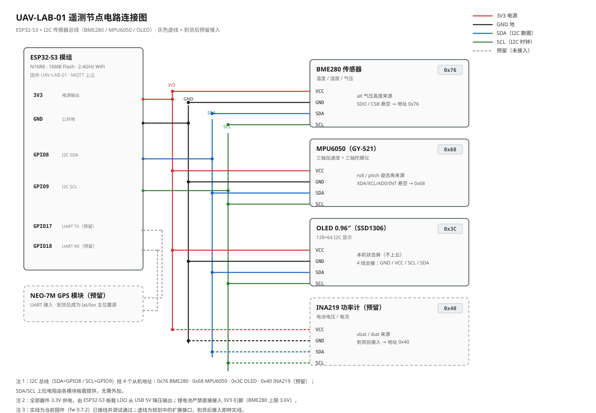

# 04_uav_telemetry_mqtt — 契约 v1.0 遥测上云节点（母机 UAV-LAB-01）

对应《实验平台执行任务书》T1.3：WiFi + MQTT 按契约上云——**全项目第一条真实硬件遥测链路**。

| 状态 | 说明 |
|------|------|
| 2026-10-20 | 骨架完成，`pio run` 编译通过；板未插，尚未烧录。待：填凭据 → 烧录 → 树莓派在线后验收 |
| 2026-10-22 | BME280 到货接入：I2C（SDA=8/SCL=9），`alt` 由 null → 实测气压高度；传感器验收走根目录 `05_i2c_bme280`（`./run.sh bme`） |
| 2026-10-22（T1.2） | **fw 0.6.0**：MPU6050 裸寄存器驱动接入（roll/pitch 实测）、OLED 本机状态屏上线。烧录 `./run.sh telemetry`，看板识别凭证 = fw 字段变 0.6.0 |
| 2026-10-23 | **fw 0.6.1**：WiFi 粗定位兜底（BSSID 查表上报 lat/lon，家庭锚点已录入） |
| 2026-10-23 | **fw 0.6.2**：静态噪声治理——MPU6050 开 DLPF 低通（0x1A←3，加速度带宽 260→44Hz）、BME280 开 IIR 滤波（FILTER_X16 + 气压过采样 ×16），桌面静止时 roll/pitch 与 alt 曲线的本底抖动约降一半以上；数字级滤波（互补/卡尔曼）仍留给毕设 #4 |
| 2026-10-23 | **fw 0.7.0**：运行期配置——WiFi/broker 地址/端口存 NVS（`wifi_secrets.h` 降级为出厂默认值）；连不上网 45s 自动开 SoftAP 配网热点 `UAV-LAB-01-Setup`（按住 BOOT 键上电强制开），手机网页改配置零烧录；broker 支持 mDNS 主机名（`pi-matnoble.local`），换网不用改 IP |
| 2026-10-23 | **fw 0.7.1**：连接体验修复——重连不再每 30s disconnect 打断底层握手（首连 45s 拖延的元凶）、`[NTP]` 日志 10s 节流、WiFi 连通后自动关闭配网热点（BOOT 强制配网除外） |
| 2026-10-23 | **fw 0.7.2**：家庭锚点补第二台 AP（同名 SSID 背后多台物理 AP——表按 BSSID 匹配，连上哪台都要有行，每台一行）；`[WiFiPOS]` 日志带 SSID 便于辨认 AP 归属；**真实 BSSID/坐标表拆至 gitignore 的 `wifi_pos_private.h`，仓库可安全推送** |

## 接线



> 电路连接图（论文可直接引用）：实线 = 已接线调试通过；虚线 = INA219 / NEO-7M 到货后的预留接口。

BME280（3.3V 款）四线：母对母直连，或面包板 + 公对公跳线均可（接法细节见根目录 `05_i2c_bme280` README；6 焊盘款的 CSB/SDO 悬空）：

| BME280 | ESP32-S3 | 备注 |
|--------|----------|------|
| VCC | 3V3 | 3.3V 款无稳压，严禁 5V |
| GND | GND | 共地 |
| SCL | GPIO 9 | 四传感器共享 I2C 总线 |
| SDA | GPIO 8 | |

## 首次使用

1. 编辑 `src/wifi_secrets.h`（已 gitignore），填三个值：
   - `WIFI_SSID / WIFI_PASS`：家庭 WiFi（**必须 2.4GHz**，ESP32 不支持 5G）
   - `MQTT_HOST`：推荐 `pi-matnoble.local`（树莓派 mDNS 主机名，换网不用改 IP）；也可填局域网 IP（Pi 上 `hostname -I` 查）
   - （可选，粗定位）复制 `src/wifi_pos_private.example.h` 为 `src/wifi_pos_private.h`，按串口 `[WiFiPOS]` 提示填 BSSID+坐标行（同名 SSID 每台 AP 一行）；不复制也能正常上云，只是 lat/lon 报 null
2. 插板（UART/COM 口），烧录 + 监视：

   ```bash
   ./run.sh telemetry
   ```

3. 串口出现 `[遥测 #000001] seq=1 已发布` 即链路打通。

## 换网 / 配网（fw 0.7.0 起，零烧录）

连接类配置（WiFi 名/密码、broker 地址/端口）存在 **NVS**（flash 分区，普通重烧固件不丢）；`wifi_secrets.h` 退为"出厂默认值"，只在 NVS 为空（首次上电或整片擦除后）时播种。

**换 WiFi / 换 broker 的标准流程**（不需要电脑）：

1. 设备连不上 WiFi 且开机 45 秒后，自动开放配网热点 **`UAV-LAB-01-Setup`**（无密码）；OLED 显示 `AP Setup 192.168.4.1`，串口有 `[PORTAL]` 提示；
2. 手机连上该热点，自动弹出配网页（不弹就浏览器访问 `http://192.168.4.1/`）；
3. 表单里选/填 WiFi 名称、密码（留空 = 沿用已存），broker 地址一般不用动（`pi-matnoble.local` 跨网有效）；
4. 点"保存并重启"，设备自动重启并连新网，热点消失。

**强制进配网**：换网欲望强烈但设备还连着旧网时，按住 BOOT 键上电（或复位），立即开热点。

边界：配网热点无密码，仅在设备**离线**状态下开放（在线时不可触发，BOOT 强制除外）；AP 与 STA 并存，配网期间固件仍按原配置继续尝试连网，保存重启后切新网。mDNS 解析失败会每 5s 重试，Pi 离线时遥测暂停但不崩溃，恢复后自动续上。

## 验收（任务书 T1.3 标准）

- S0 看板（https://uav.matnoble.top）出现 UAV-LAB-01 曲线实时跟动；
- 或在 Pi 上 `uav-lab/venv/bin/python tools/validate_telemetry.py --broker <Pi-IP>`，观察条数递增、seq 零缺口、延迟毫秒级。

## 当前边界（后续任务接入点）

- **WiFi 粗定位兜底（fw 0.6.1）**：连上 `wifi_pos_private.h` 表内已知 AP 时 lat/lon 按表上报（粒度 = AP 的位置）；未命中或无 GPS 一律报 null。BSSID 采集 = 串口 `[WiFiPOS]` 行；坐标拾取 = lbs.amap.com/tools/picker。NEO-7M 到货后真 GPS 优先，本机制转为失锁兜底（高德已不对第三方开放 WiFi 扫描定位 REST 接口，自建 BSSID 表是零成本正解）；
- **alt 已接入（2026-10-22）**：BME280 气压高度，按契约 §2 报"相对上电零点"（开机连采 8 次自动定零），传感器缺席自动回退 null；
- **roll/pitch 已实测（T1.2，fw 0.6.0）**：MPU6050 裸寄存器驱动（自 06 搬运），加速度计静止姿态角（atan2 重力投影）；晃动会漂属预期——互补/卡尔曼滤波是毕设 #4 的正戏，届时本驱动即对照组；
- **yaw 暂报 null**：需陀螺仪积分+滤波（自由漂移），落地前按契约报 null 不冒充；
- **OLED 本机状态屏**：seq/RSSI/MQTT/姿态/alt 现场显示，不上云；GFX 默认字库仅 ASCII，勿写中文；
- **06 与 04 的分工**：`06_i2c_sensor_suite` 是传感器台架（无 WiFi/MQTT，不上云），04 才是上云节点——大屏只认 04；
- **QoS**：PubSubClient 固定 QoS0 发布（契约 §7 注记允许，丢包靠 seq 缺口度量）；确需 QoS1 时换 ArduinoMqttClient，报文格式不变；
- **S2 断连补传**：`mode` 目前恒为 `NORMAL`；环形缓冲 + BUFFERING/DEGRADED 状态机在 S2 实现；
- **NTP 门槛**：对时成功前不发布（契约要求 ts 为有效 Unix 毫秒），串口会提示。
